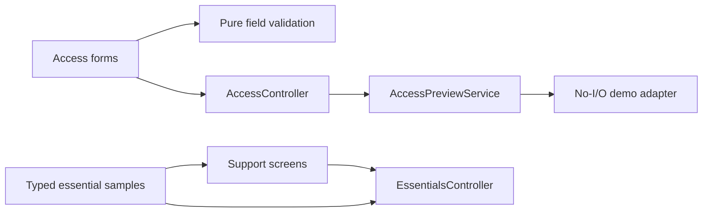

# Architecture and SOLID

The composition root is `lib/main.dart`. It creates a controller from contracts
and device adapters. Widgets obtain the controller through a small inherited
notifier; no service locator or global mutable singleton is used.

| Layer | Location | Responsibility |
|---|---|---|
| Domain | `lib/domain/` | Typed visits, inspection data, contracts and submission policy |
| Data | `lib/data/` | Typed sample lists, local JSON persistence, native picker and Maps adapters |
| Application | `lib/application/` | Search, lifecycle, save/submit state, error handling |
| Presentation | `lib/presentation/` | Small screens, fields and reusable visual components |
| App/core | `lib/app/`, `lib/core/` | Composition scope, locale, theme and motion tokens |

- **Single responsibility:** the picker adapter never renders UI; the store never
  handles navigation; the policy validates; views compose reusable widgets.
- **Open/closed:** add a production `DraftStore`, `VisitRepository`,
  `AttachmentService` or `DirectionsService` by implementing its contract and
  changing the composition root.
- **Liskov substitution:** regression tests use fake implementations of the same
  contracts, including cancellation and failure behavior.
- **Interface segregation:** visits, storage, attachments and directions have
  separate narrow interfaces.
- **Dependency inversion:** the controller depends on these contracts and an
  injected clock/policy. Widgets do not import picker/storage plugins.

State uses Flutter's `ChangeNotifier`; the scope is deliberately small for this
initial app. Each inspection belongs to a visit ID. Starting an existing draft
preserves its ID and start time. Submission validates the complete checklist and
result, then persists before navigation. Failed persistence restores submission
timestamps and keeps the draft open. Back navigation saves first; failed saves
prevent leaving. A restoration failure blocks writes to protect stored drafts.

The JSON schema is versioned in the preferences key. Photos/PDFs are bounded and
serialized as base64 for this prototype. This is not appropriate storage for
real tax records; production needs transactional encrypted storage, identity,
authorization, migrations and an authenticated backend.

## Data

`lib/data/sample_data.dart` owns visits, checklist items, priorities, finding
types, weekdays and inspector display names. UI labels are translated separately
using `context.tr`. Demo date is fixed to 11 November 2026 to match the references;
actual start/submission times use the injected clock. Completed count is derived
from records, so the initial progress is 25% (one completed visit out of four).
The screenshot's 50% label is not used because its list provides only one
completed record.

## Access and essentials (0.4.0)

`AccessController` depends on the narrow `AccessPreviewService` contract.
`DemoAccessService` performs no I/O and stores no request. Forms own temporary
text controllers, validate through pure `AccessValidation`, dispose controllers
on exit and show an explicit preview result. Successful form validation does not
start the demo until the user selects Open demo. `main.dart` injects this flow;
the optional controller lets shell-only widget tests mount the inspection UI.
This is UI composition, **not an authentication or authorization boundary**.
Real accounts require a separately designed authenticated session/backend flow.

`EssentialsController` owns a read-only list of notification records and a
session-only set of read IDs. It never writes drafts or preferences. Onboarding,
help and notification content live in `lib/data/essential_samples.dart`.
`AccessScope` and `EssentialsScope` expose injected state to routes. Ending the
demo pops routes to the root and resets navigation without deleting local data.

