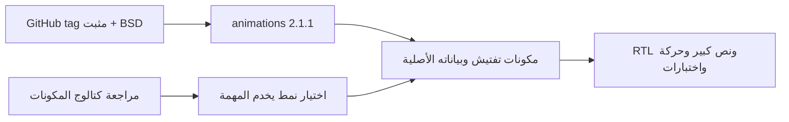

# مصادر المكونات والتراخيص — 0.5.0

| المصدر | الاستعمال | الترخيص / طريقة الدمج |
|---|---|---|
| [Flutter Component Library](https://fluttercomponentlibrary.com/) | مراجعة تصميم Snackbar والفهرس والمكونات | مرجع بصري؛ عارض المصدر كان فارغًا، لا كود منسوخ |
| [animations 2.1.1](https://pub.dev/packages/animations/versions/2.1.1) | تحول بطاقة الزيارة وانتقال التبويبات | اعتماد مباشر مثبت، BSD-3-Clause |
| [مثال OpenContainer](https://github.com/flutter/packages/blob/animations-v2.1.1/packages/animations/example/lib/container_transition.dart) | نمط closedBuilder/openBuilder للزيارة | تكييف مع بيانات تفتيش وRTL وتقليل الحركة |
| [مثال FadeThroughTransition](https://github.com/flutter/packages/blob/animations-v2.1.1/packages/animations/example/lib/fade_through_transition.dart) | PageTransitionSwitcher للشاشات الرئيسية | تكييف مع التبويبات القائمة؛ الإشعارات والأخطاء محفوظة |

المصدر المثبت `flutter/packages` عند tag `animations-v2.1.1`، commit
`a65a131a701a04a6abe550bcd3a5c50670283440`.
النسخة 2.1.1 تقبل Dart ^3.8.0 وFlutter >=3.32.0؛ توافق SDK المشروع 3.35.4.
النسخة 3.0.0 تحتاج Dart ^3.12.0 وFlutter >=3.44.0، لذلك لا تُستخدم هنا.

ترخيص الحزمة مضمن بواسطة آلية تراخيص Flutter. نسخة الإشعار النصي في
`docs/licenses/animations-BSD-3-Clause.txt`. ملفات التكييف تذكر المصدر وتوضح
التغييرات. الصور المولدة للمشروع موثقة مستقلًا في GENERATED_ASSETS.md.
