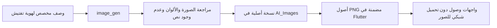

# الصور الأصلية — 0.4.0

أنشئت الصورتان بأداة **image_gen** المدمجة؛ لم تستخدم صورًا جاهزة من الإنترنت
أو بدائل SVG. صيغة PNG بدقة 1536×1024؛ دون نصوص أو شعارات أو أشخاص.
الصور توضيحية فقط، ولا تمثل مؤسسات أو مستندات أو شهادات أمنية حقيقية.
تعرض داخل Flutter كصور زخرفية مع استبعادها من شجرة القارئ؛ العناوين نصوص فعلية.

| الأصل المضمن | الاستخدام | النسخة الأصلية المحلية |
|---|---|---|
| `assets/images/field-welcome.png` | الترحيب والدخول والتعريف | `D:\AI_Images\tax-mobile-field-welcome-v1.png` |
| `assets/images/access-folio.png` | التسجيل والاستعادة والتعريف | `D:\AI_Images\tax-mobile-access-folio-v1.png` |



## النص الأول

```text
Use case: stylized-concept. Create one polished original raster illustration for the welcome/login screens of 'Tafteesh', an Arabic field-inspection Flutter app in Libya. No words, no text, no logos, no watermark, no people. Editorial architectural miniature: a Libyan Mediterranean street corner with a white arched storefront and mint-teal shop canopy, a large professional inspection clipboard/tablet with three neat check marks in the foreground, a small location pin and a slender olive branch. Sophisticated tactile 3D paper/ceramic materials, controlled asymmetry, architectural precision, soft daylight and believable shadows. Palette drawn from app: deep teal #006B65, mint #E7F5F0, white #FFFFFF, pale cool background #F5F9F8, muted ink #102F3B and a tiny warm brass accent only. Landscape 3:2 composition, whole subject entirely inside central 80% with clear edges and generous breathing room, suitable to crop to a wide shallow banner or display as a standalone illustration. Background solid very pale mint, no UI cards or mockup screens. Quiet premium civic-service feel, clean non-cartoonish craftsmanship, high quality.
```

## النص الثاني

```text
Use case: stylized-concept. Create a second original editorial illustration for account setup and recovery in an Arabic field-inspection app, matching a refined tactile ceramic/paper 3D civic-service visual identity. No text, letters, numbers, logos, watermark, people or UI mockup. A deep teal professional document folio opened slightly, neatly arranged white inspection sheets with abstract blank rows and a simple large teal check mark, a beautifully crafted brass key resting beside the folio, and a small mint ceramic shield with a keyhole, on a pale cool mint architectural plinth. Sparse olive leaves anchor the composition. Quiet professional tabletop still life, strong physical materials and subtle imperfections, soft Mediterranean daylight, polished but not toy-like. Colors #006B65 teal, #E7F5F0 mint, #F5F9F8 background, white, #102F3B ink, tiny warm brass. Landscape 3:2 composition with all subjects inside central 80% and generous clear margin; solid very pale mint background. The image is decorative conceptual art and must not contain a person, real credentials, or any claim of certification/security.
```
