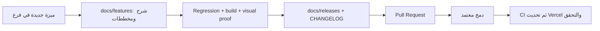

# وثائق المشروع

كل ميزة لها ملف مستقل يشرح السلوك والحدود والفحص مع مخطط Mermaid.
كل إصدار له ملف يربط الميزات التي يتضمنها. هذه سياسة مستمرة في AGENTS.md.

| المرجع | المحتوى |
|---|---|
| [سجل الإصدارات](CHANGELOG.md) | فهرس الإصدارات والتغييرات |
| [تدفق التفتيش](features/001-inspection-flow.md) | الشاشات والزيارات والمسودات |
| [معاينة Vercel](features/002-vercel-preview.md) | الدمج، CI، النشر وإثبات commit |
| [ملف المفتش](features/003-inspector-profile.md) | الصورة والإعدادات وSlivers |
| [إصلاحات مراجعة Qodo](features/004-qodo-review-fixes.md) | الاستعادة وفحص السياسة وزر اللغة |
| [تحسين تصميم الملف](features/005-profile-design-polish.md) | بطاقة المفتش والاختيارات والحركة |
| [الوصول والترحيب](features/006-access-experience.md) | الدخول والتسجيل والاستعادة والتعريف |
| [الأساسيات](features/007-app-essentials.md) | المساعدة والخصوصية والإشعارات والخروج |
| [تحسين المكونات](features/008-component-library-ui.md) | الرئيسية والتنقل والكود الجاهز وإتاحة المستودع |
| [مصادر المكونات](COMPONENT_SOURCES.md) | GitHub والمكتبة والإصدارات والتراخيص |
| [الصور الأصلية](GENERATED_ASSETS.md) | الملفات وprompts وأداة التوليد |
| [أنماط الواجهة](UI_PATTERNS.md) | الألوان والحركة والتمرير والوصول |
| [المعمارية](ARCHITECTURE.md) | العقود وفصل المسؤوليات |
| [الحزم](PACKAGES.md) | الاعتمادات والمنصات والتراخيص |
| [التحقق](VERIFICATION.md) | أدلة النسخة الأساسية وحدودها |

