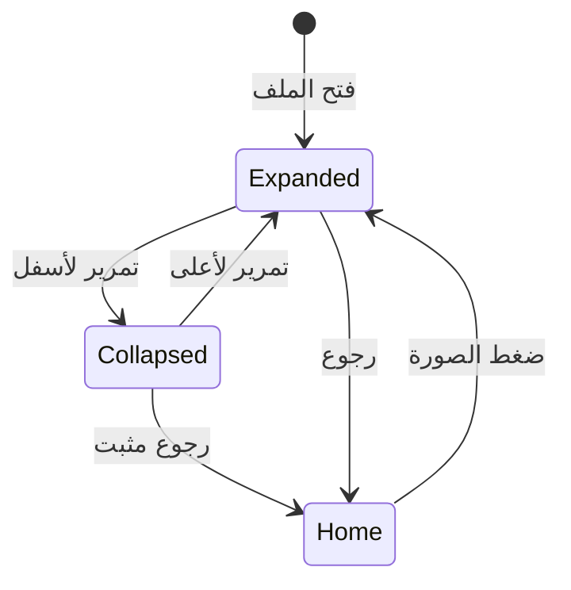

# أنماط الواجهة والحركة

المرجع Flutter Material 3 بهوية تفتيش الموجودة: Cairo مضمن، أخضر teal،
خلفية هادئة وبطاقات بيضاء بحدود ناعمة. القيم المشتركة في `Palette` و`Space`.

| النمط | التطبيق | السبب |
|---|---|---|
| SliverAppBar مثبت وبطاقة هوية | الملف الشخصي | صورة واضحة ومحاذاة بيانات مع بقاء الرجوع متاحًا |
| SliverPadding + SliverList | PageBody المشترك | تمرير موحد وقوائم تبنى حسب الحاجة |
| Hero + FadeTransition | فتح الملف من الصورة | ربط واضح بين الزر والوجهة |
| MotionTokens + CollapseMode.pin | الانتقالات والتبويبات ورأس الملف | تعطيل انتقالات الزخرفة وparallax عند تقليل الحركة |
| ChoiceChip داخل Wrap | اللغة وحجم النص | خيارات ظاهرة، التفاف عند ضيق الشاشة |
| Semantic tooltip + 48px | الصورة والرجوع والإجراءات | الوصول باللمس والقارئ ولوحة المفاتيح |
| PreferenceTextScaler | كل التطبيق | إضافة تفضيل النص دون تجاهل تكبير النظام |
| حد المحتوى 780px | الشاشات والملف | قراءة مريحة على الهاتف والشاشات الواسعة |
| تأكيد استعادة الإعدادات | تلف بيانات الملف المحلي | توضيح ما سيستبدل مع الحفاظ على المسودات |
| canEdit مشترك | إعدادات الملف وزر اللغة | تعطيل الإجراءات أثناء الاستعادة والحفظ وتجنب أخطاء زائفة |
| AnimatedAlign في مجموعة اختيار | اللغة وحجم النص | بيان الاختيار بعد نجاح الحفظ مع دعم RTL/LTR |
| AnimatedScale داخل مساحة لمس ثابتة | صورة المفتش | استجابة ضغط دون تقليص منطقة اللمس |
| انتقال صفحة يتابع إعداد الحركة | صفحة الملف المفتوحة | خروج فوري عند تفعيل تقليل الحركة قبل الرجوع |

`silver widgets` في الطلب نُفذت كـ Flutter **Sliver widgets** للتمرير.
لا blur ثقيل أو مكتبة حركات جديدة. الصورة رمزية حتى اختيار صورة المستخدم.
النص العربي لا يُقسم إلى حروف، واتجاه الصفحة تحدده Flutter Localizations،
ولا يُفرض RTL مرة ثانية على HTML. تقليل الحركة يوقف انتقالات الزخرفة.
