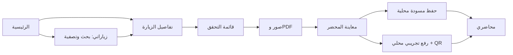

# 001 — تدفق التفتيش التجريبي

الإصدار: [0.1.0](../releases/0.1.0.md). أُضيفت الشاشات من المراجع المرفقة.
القوائم النموذجية في `SampleData`، والعقود في domain، والمنطق في
`InspectionController`، والتخزين والخدمات في data، والعرض في presentation.

المسودة تحفظ عند الطلب والرجوع؛ فشل الحفظ يمنع مغادرة النموذج.
الرفع المحلي يحتاج اكتمال البنود والنتيجة ونوع الملاحظة إن وجد.
حد المرفقات: 6 للمحضر، 2 MB للملف. PDF مرفق دون قارئ داخلي.

التحقق: اختبارات controller/navigation/layout؛ صور الشاشات في
`docs/screenshots/01-*.png` إلى `07-*.png` والتفاصيل في
[VERIFICATION](../VERIFICATION.md). CI يبني APK؛ أذونات الأجهزة تحتاج تحققًا فعليًا.
لا مصادقة أو GPS أو API أو اعتماد رسمي؛ الخرائط والبيانات توضيحية.
