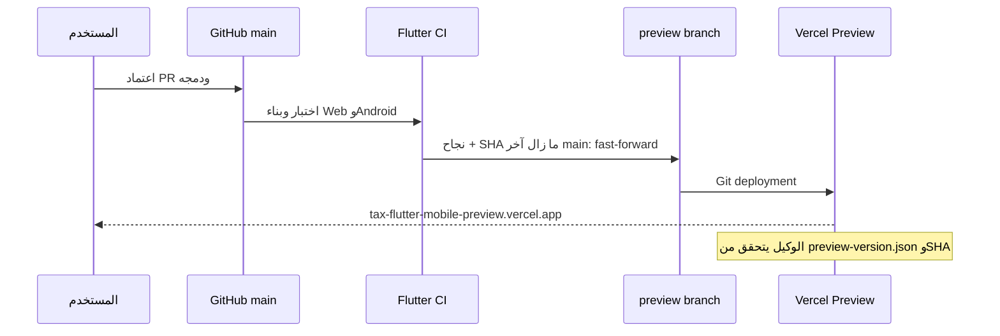

# 002 — معاينة Vercel بعد الدمج

الإصدار: [0.1.0](../releases/0.1.0.md). PR #1 للشاشات وPR #2 للنشر
دُمجا بموافقة المستخدم. إعداد الحساب والتفاصيل في
[VERCEL_PREVIEW](../VERCEL_PREVIEW.md).

لا push مباشر إلى main ولا force-push لفرع preview. نشر main إلى Production
معطل في إعداد Vercel؛ النطاق التجريبي مربوط بفرع preview. تظل الحماية مفعلة.
قد يلزم تسجيل دخول Vercel للمشاهدة. لا تغيير لبيئة إنتاج ولا توكن في GitHub.

الفحص يشمل metadata وcache headers وتعطيل service worker. الوكيل الذي يدمج
يتابع CI والنشر حتى READY ثم يقارن SHA المنشور بـ main؛ نجاح build وحده لا يكفي.
معاينات الميزات لها روابط مستقلة حتى اعتماد الدمج.
