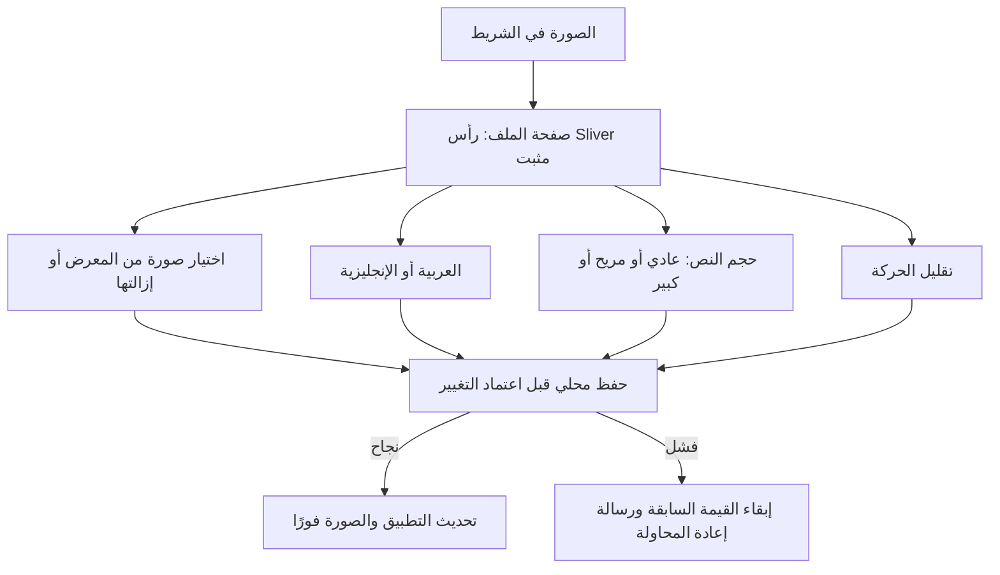
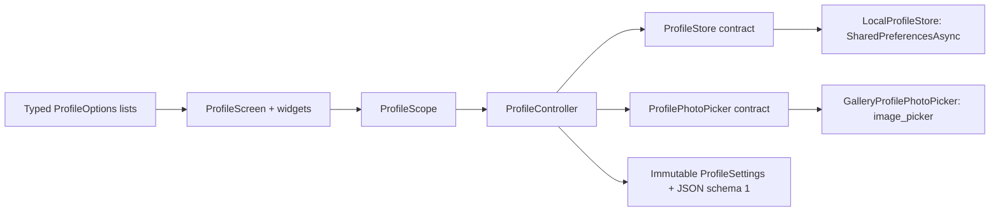

# 003 — صورة المفتش والملف الشخصي والإعدادات

الإصدار: [0.2.0](../releases/0.2.0.md).
استُبدلت كلمة تفتيش في الشريط العلوي بزر صورة دائري بلمسة 48px وتسمية وصول.
يفتح صفحة جميلة برأس متدرج، صورة أكبر، اسم العينة وبطاقات إعدادات واضحة.
لا صورة بشرية افتراضية؛ يظهر رمز شخص حتى يختار المفتش صورته.

## السلوك والحدود

- المفتاح `inspector_profile_v1` مستقل عن المسودات؛ لا يُحذف أي سجل تفتيش.
- طلب الصورة 640×640 وجودة 80؛ الحد بعد الاختيار 512 KB. إلغاء المنتقي لا يغير شيئًا.
- فشل الاستعادة يمنع الكتابة حتى إعادة المحاولة؛ فشل الحفظ يبقي القيمة السابقة.
- تلف بيانات الملف يتيح استعادة الإعدادات الافتراضية بعد التأكيد، مع بقاء المسودات؛
  تفاصيل فصل التلف عن فشل I/O في [إصلاحات المراجعة](004-qodo-review-fixes.md).
- اللغة تنطبق على التطبيق كله وتبقى بعد إعادة التشغيل. اسم المفتش عينة قائمة موجودة.
- النص يضاعف إعداد الجهاز بعامل 1 أو 1.15 أو 1.3؛ لا يعطل تكبير النظام.
- تقليل الحركة يحترم إعداد الجهاز أيضًا؛ Hero وFade وتبديل التبويبات تستخدمه.
- SliverAppBar ينطوي ويبقي الرجوع ظاهرًا؛ SliverPadding/SliverList للصفحات المشتركة.
- الصورة والتفضيلات محلية غير مشفرة، ولا API/حساب فعلي/رفع خادم. لا تستخدم بيانات حساسة.
- حدود المتصفح ومسح التخزين أو وضع التصفح الخاص قد تزيل التفضيلات.
- لا توجد حزم جديدة؛ راجع [PACKAGES](../PACKAGES.md) و[UI_PATTERNS](../UI_PATTERNS.md).

## التحقق

اختبارات `profile_controller_regression_test.dart` تغطي الاستعادة والحفظ والفشل
والإزالة والإلغاء والحجم. اختبارات `profile_widget_regression_test.dart` تغطي
فتح الملف والصورة واللغة والحركة وفشل الحفظ وRTL/LTR عند 360 و900 وتكبير 1.3.
أدلة الفحص المرئي والمتصفح تُسجل في ملف الإصدار بعد التشغيل.
اختيار صورة على Android/iOS يحتاج تحقق جهاز فعلي؛ لا ندعي اختبار صلاحياته محليًا.
