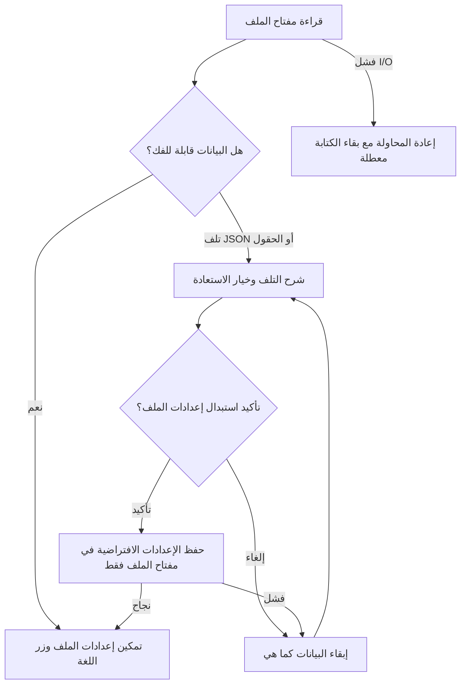

# 004 — إصلاح ملاحظات Qodo على الملف الشخصي

ضمن الإصدار [0.2.0](../releases/0.2.0.md) وPR #3، قبل اعتماد دمجه.
راجعت الملاحظات مقابل المصدر وأضفت اختبارات تفشل مع السلوك السابق ثم تمر بعد الإصلاح.

| الملاحظة | السبب والإصلاح |
|---|---|
| [قفل الملف عند تلف البيانات](https://github.com/abdalraof-albarbar/Tax-Flutter-Mobile/pull/3#discussion_r4559745515) | فصل تلف JSON عن أخطاء القراءة؛ استعادة افتراضية بعد تأكيد المستخدم، مع حفظ مفتاح الملف وحده |
| [اعتماد فحص السياسة على الحزم](https://github.com/abdalraof-albarbar/Tax-Flutter-Mobile/pull/3#discussion_r4559745517) | قراءة نسخة العرض كنص دون package import؛ تشغيل الفحص واختباراته مباشرة من Dart SDK قبل pub get |
| [رسالة فشل لغة أثناء الانشغال](https://github.com/abdalraof-albarbar/Tax-Flutter-Mobile/pull/3#discussion_r4559745521) | تعطيل الزر حتى استعادة الملف وانتهاء الحفظ، وحماية الضغط المتكرر قبل الرسم؛ الرسالة لفشل حفظ فعلي فقط |

ملاحظة دقيقة حول الفحص: `dart run` قد يحاول حل الاعتمادات تلقائيًا، لذلك كانت
فحوص CI السابقة ناجحة. العيب هو أن بوابة يفترض عملها قبل إعداد الحزم تعتمد على
package configuration. الأمر الحالي `dart tool/check_project.dart` لا يحتاج ذلك.

لا تُحذف البيانات التالفة تلقائيًا، ولا يستدعي الإصلاح clear على التخزين.
المفتاح `inspection_demo_v1` للمسودات يبقى محفوظًا. فشل إعادة الضبط يحتفظ
بالقيمة السابقة، ويتيح المحاولة مجددًا. أخطاء I/O الحقيقية تعرض إعادة القراءة
ولا تعرض زر استعادة البيانات التالفة.

التحقق:

- `profile_recovery_regression_test.dart`: سبع حالات تلف، الإلغاء والتأكيد، فشل
  إعادة الضبط والمحاولة مجددًا، والحفاظ على المسودات وفصل فشل القراءة الحقيقي.
- `language_shortcut_regression_test.dart`: استعادة مؤجلة، ضغطتان سريعتان أثناء
  حفظ مؤجل، واستمرار رسالة الخطأ عند فشل التخزين فعليًا.
- `dart tool/test_project_policy.dart`: تشغيل نسخة من البوابة في Git fixture
  دون حزم، وتشخيص غياب version ورفض اختلاف نسخة العرض. يستخدم SDK فقط.
- CI يشغّل اختبارات السياسة قبل حل الاعتمادات، ثم التحليل واختبارات Flutter
  وبناء Web وAndroid. أدلة النتيجة النهائية تُسجل في PR #3.

لا توجد حزم جديدة أو تغيير لإصدار منشور؛ الإصلاحات جزء من PR الإصدار 0.2.0 المفتوح.

الأدلة المحلية: نجحت اختبارات Flutter الـ48 وحالات SDK الثلاث والتحليل وبناء Web.
في Chrome عند 360×800، ظهرت [نافذة التأكيد](../screenshots/12-profile-recovery-confirmation.png)
وأعادت الإعدادات إلى القيم الافتراضية مع بقاء مفتاح المسودات، وعادت عناصر
التحكم للعمل. لم تظهر أخطاء console. استُخدم ملف متصفح QA مستقل ببيانات اختبار فقط.
