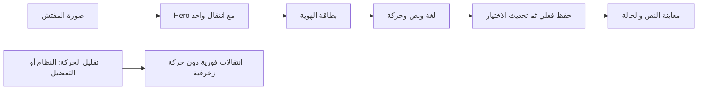

# 005 — تحسين تصميم ملف المفتش والحركة

اتجاه الإصدار 0.3.0، في فرع مستقل مبني على PR #3 للإعدادات وإصلاحات Qodo.
المهارات المستخدمة: flutter-design وflutter-animation وfrontend-design.

## اتجاه التصميم قبل التنفيذ

- الهوية: بطاقة تعريف للمفتش داخل تطبيق عمل ميداني، مع توضيح أنها بيانات تجريبية.
- الألوان: deep teal `#006B65`، teal `#00867E`، ink `#102F3B`، mint `#E7F5F0`،
  background `#F5F9F8`، white `#FFFFFF`؛ تستخدم قيم الثيم الموجودة.
- الخط: Cairo المضمن؛ الاسم headlineMedium، الأقسام titleMedium، والشرح bodySmall.
- التكوين: رأس Sliver مثبت، بطاقة هوية بمحاذاة البداية حسب RTL/LTR، ومجموعة
  إعدادات هادئة بأقسام اللغة والنص والحركة، ثم شرح موجز للتخزين المحلي.
- العلامة البصرية: شريط teal على حافة بطاقة الهوية وصورة دائرية مع إجراء كاميرا.
- الحركة: Hero للصورة وfade واحد للصفحة، مؤشر اختيار منزلق، وضغط خفيف للصورة؛
  جميعها مرتبطة بتفاعل المستخدم وتحترم إعداد تقليل الحركة فورًا.

```text
  [رجوع]                 الملف الشخصي
  ╭─────────────────────────────────╮
  │ الاسم وبيانات التجربة   [الصورة] ▌│
  │                     تغيير الصورة│
  ╰─────────────────────────────────╯
             حالة الحفظ المحلي
  تفضيلاتك
  ╭─────────────────────────────────╮
  │ اللغة           [عربي | English]│
  ├─────────────────────────────────┤
  │ حجم النص       [عادي|مريح|كبير] │
  │               معاينة باسم المفتش│
  ├─────────────────────────────────┤
  │ تقليل الحركة                [↔] │
  ╰─────────────────────────────────╯
        التخزين المحلي ومعلومات الإصدار
```

مراجعة الاتجاه: المحاذاة تشبه بيانات نموذج التفتيش، والاسم والصورة هما مركز
الصفحة. تجمع التفضيلات داخل سطح واحد، وتبقى الملاحظات والخصوصية بمستوى بصري
أهدأ. يظهر التمييز الأساسي في بطاقة الهوية، وتُستخدم الحركة لتفسير الأفعال فقط.



تظل بيانات المفتش والخيارات مشتقة من قوائم data. لا تُضاف بيانات حساب أو
إحصاءات أو صورة بشرية غير موجودة في المشروع.

## التحقق والنتيجة

- نجحت 61 من اختبارات Flutter و3 حالات لبوابة السياسة، والتحليل دون ملاحظات.
- نجح بناء Web بوضع profile وبوضع release. راجعت Chrome عند 430×932 و360×800
  و900×850 و240×800. اختبارات الواجهة شملت النص عند 1.3× ومع تكبير النظام وصولًا إلى 2.08×.
- اختبارات لوحة المفاتيح تتحقق من التركيز والاختيار والتفعيل بـEnter. اختبار
  الرجوع أثبت فشل السلوك السابق ثم نجح عند تفعيل تقليل الحركة داخل الصفحة.
- اختبار نافذة اختيار الصورة أثبت تعطيل حركة فتحها وإغلاقها عند تفعيل تقليل
  الحركة. تستخدم نافذة تأكيد الاستعادة نفس AnimationStyle المتوافق مع التفضيل.
- أظهرت مراجعة Qodo تجاوزًا عند 240px، وأثبت الاختبار تجاوزًا بـ142px. أصبحت
  بطاقة الهوية Sliver بمقاس محتواها، مع ترتيب رأسي بحسب المساحة وتكبير النص.
  يقاس ارتفاع عنوان الشريط وفق النص بدل قصه، ويحترم تكبير النظام كاملًا.
  نجحت ست حالات عند 240/280px
  باللغتين، وتشمل تكبير 2.08× دون فقدان التمرير أو التفضيلات.
- التباين المحسوب: الأبيض مع deep teal يساوي 6.38:1؛ ink على mint يساوي 12.55:1؛
  الشرح muted على mint يساوي 4.58:1. يستخدم البروفايل primary أغمق محليًا.
- قياس Chrome DevTools Protocol مع requestAnimationFrame في profile mode،
  خلال تغيير حجم النص مرتين في التخطيط النهائي: 147 فترة؛ الوسيط 6.9ms وp95
  نحو 12.9ms. ظهرت فترتان فوق 33.4ms، والحد الأقصى 97.2ms.
  هذا قياس وتيرة المتصفح لعينة قصيرة، وليس تتبع Flutter UI/raster على هاتف؛
  لا يثبت ثبات 60/120fps. يبقى قياس الأجهزة وTalkBack/VoiceOver تحققًا مستقلًا.
- لا حركة تلقائية مستمرة أو controllers إضافية مملوكة للتطبيق؛ يدير Navigator
  متحكم الانتقال، وتقتصر setState على أحداث الضغط والتركيز.

اللقطات:

- [الهاتف بالعربية](../screenshots/13-profile-polish-ar.png).
- [التخطيط الواسع بالإنجليزية](../screenshots/14-profile-polish-wide-en.png).
- [النص الكبير والرأس المثبت](../screenshots/15-profile-polish-large-ar.png).
- [عرض 240px والنص الكبير](../screenshots/16-profile-polish-narrow-ar.png).
