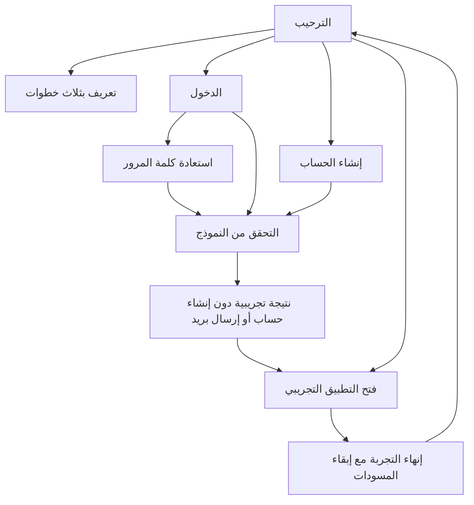

# 006 — الترحيب والدخول وإنشاء الحساب

## خطة التصميم

المهارات: flutter-design، flutter-animation، frontend-design وimagegen.
الجمهور مفتش ميداني؛ صفحة الدخول امتداد لهوية تفتيش الحالية.

- الألوان: deep teal `#006B65`، ink `#102F3B`، mint `#E7F5F0`،
  background `#F5F9F8`، white `#FFFFFF`، amber `#946000` للحالات التنبيهية.
- الخط Cairo المضمن؛ headlineLarge للعناوين، titleMedium لتسميات الحقول،
  bodyMedium للشرح. محاذاة البداية RTL/LTR، دون تقسيم العربية إلى حروف.
- العنصر البصري المميز رسمان أصليان لمتجر متوسطي وقائمة تفتيش، وملف مستندات.
- الهاتف: تمرير واحد، رسم صغير قبل النموذج، أزرار واضحة، وتسميات خارج الحقول.
  النافذة الواسعة: عمود للرسم والسياق، وعمود للنموذج. لا صور متحركة مستمرة.
- الحركة توضح الانتقال والإتمام فقط، وتحترم النظام والتفضيل المحلي.

```text
  [رجوع]     تفتيش                 [EN]
  [رسم ميداني أصلي]
  أهلًا بعودتك
  [وصف موجز + توضيح التجربة]
  البريد الإلكتروني
  [                             ]
  كلمة المرور
  [                         عرض ]
               نسيت كلمة المرور؟
  [         تسجيل الدخول        ]
  [إنشاء حساب]    [تجربة التطبيق]
```

مراجعة الاتجاه: نستخدم مجال التفتيش والعمارة المحلية بدل صورة حساب عامة،
ونبقي بقية الصفحة هادئة؛ تسميات الحقول تظهر دائمًا، والتخطيط يتبع عرض النافذة
وتكبير النص. لا شعارات رسمية أو ادعاءات أمنية أو هوية أشخاص مولدة.

## السلوك والحدود

الواجهات تشمل الترحيب، تعريفًا بثلاث خطوات، الدخول، إنشاء الحساب، استعادة
كلمة المرور ونتيجة النموذج. النماذج تتحقق من المدخلات وتتيح إظهار كلمة المرور.
التجربة لا تنشئ حسابًا، ولا ترسل بريدًا أو رمز تحقق، ولا تحفظ كلمات المرور.
لا توجد مصادقة حقيقية أو صلاحيات خادم. خدمة المعاينة محقونة خلف واجهة مستقلة.
يمكن استكشاف التطبيق دون إدخال بيانات. إغلاق الجلسة التجريبية لا يحذف المسودات
أو الصورة أو التفضيلات. حالة النماذج مؤقتة وتُتلف متحكماتها عند مغادرتها.



## التحقق

اختبارات السلوك تغطي الترحيب والتعريف والدخول والتسجيل والاستعادة، وفشل الخدمة
وإعادة المحاولة، ومطابقة كلمة المرور، وتأكيد حدود التجربة، ومنع الطلب المتكرر
وإغلاق التجربة مع الحفاظ على المسودات. التحقق من الأسماء يدعم العربية.
اختبارات التخطيط تغطي 240×800 و360×740 و1100×850 باللغتين، وتكبيرًا مركبًا
حتى 2.08× ومحاكاة لوحة مفاتيح بارتفاع 280px.

أثبت اختبار فاشل أن التسميات الخارجية لم تكن تسمي عقدة تحرير النص لقارئ الشاشة؛
أضيفت Semantics وأصبح الاختبار ناجحًا، وأكدت شجرة Chrome أسماء البريد وكلمة
المرور وتأكيدها. ظهرت مشكلة Flutter Web 3.35 عند استخدام نوع email مع semantics؛
تستخدم الويب نوع text مع تحقق البريد، وتبقى لوحة بريد إلكتروني على Android/iOS.
مرجع المشكلة: [Flutter #173239](https://github.com/flutter/flutter/issues/173239).
بعد التعديل عمل إدخال البريد والاستعادة في Chrome دون الاستثناء السابق.

بناء Web بوضع profile ومراجعة Chrome شملت الهاتف بالعربية والتسجيل الواسع
بالإنجليزية والتسجيل عند 240px مع تكبير 1.3×. النماذج قابلة للتمرير.
قياس CDP/RAF لانتقال الترحيب إلى الدخول: 162 فترة، وسيط 6.9ms وp95 يساوي
7.1ms، وحد أقصى 55.5ms وفترتان فوق 33.4ms. هذه عينة قصيرة لوتيرة المتصفح،
وليست تتبع UI/raster على هاتف ولا إثباتًا لثبات 60/120fps.
تسجيل TalkBack/VoiceOver والأداء والأذونات على أجهزة فعلية لم يُنفذ هنا.

اللقطات:

- [الترحيب](../screenshots/17-welcome-ar.png) و[الدخول](../screenshots/18-login-ar.png).
- [التسجيل الواسع بالإنجليزية](../screenshots/19-signup-wide-en.png).
- [الاستعادة](../screenshots/20-recovery-ar.png).
- [240px مع تكبير النص](../screenshots/23-signup-narrow-ar.png)
  و[حقول النموذج بعد التمرير](../screenshots/25-signup-narrow-fields.png).

نتيجة CI والبناء النهائي ومعاينة commit تسجل في PR بعد اكتمالها.

مراجعة Qodo أظهرت رسائل فشل تتسرب بين النماذج واستبدال مسار الخصوصية أثناء
طلب معلق. فشلت أربعة اختبارات تثبت الخطأ في النموذج الجديد والنموذج نفسه،
والخصوصية أثناء الانتظار، والرجوع أثناء اكتمال الطلب. أصبحت رسالة الفشل خاصة
بمحاولة الصفحة الحالية، والخصوصية معطلة أثناء الانتظار، ولا تستبدل النتيجة
المسار إلا إذا كانت صفحة النموذج ما زالت الحالية. نجحت الحالات الأربع بعد الإصلاح.

النتيجة المحلية النهائية: 93 اختبار Flutter و3 حالات SDK-only ناجحة، وبوابة
السياسة والتنسيق والتحليل وبناء Web release ناجحة. لا حزم جديدة.
