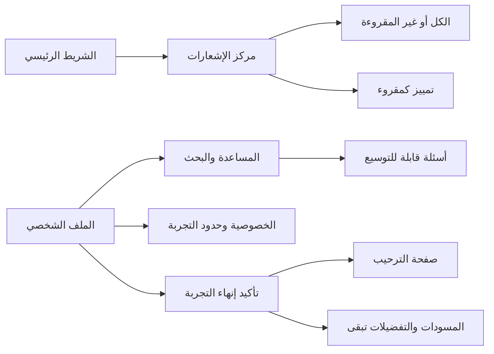

# 007 — المساعدة والإشعارات والخصوصية

تستكمل هذه الميزة صفحات الوصول بمركز مساعدة قابل للبحث، وشرح الخصوصية وحدود
التجربة، ومركز إشعارات من قائمة نموذجية مستقلة. قراءة الإشعارات حالة جلسة
محلية؛ لا توجد إشعارات دفع أو إرسال خارجي. الأسئلة والمحتوى المتكرر من قوائم.

الهوية والألوان وCairo مطابقة للتطبيق. الحالات الفارغة توجه المستخدم إلى
تغيير الفلتر أو البحث، ولا تستخدم بيانات اتصال أو جهة دعم مختلقة.
اختبارات التدفق تتحقق من البحث والتوسيع وحالة عدم وجود نتائج وإعادة الضبط،
وقراءة إشعار واحد أو الكل، وفلتر غير المقروءة واختفاء شارة الرئيسية.
اختبار تقليل الحركة فشل مع التوسيع الافتراضي ثم نجح بعد ضبط
expansionAnimationStyle: الإجابة تصبح متاحة فورًا عند اختيار تقليل الحركة
داخل التطبيق. تستعمل النوافذ والصفحات إعداد الحركة نفسه.

راجعت التدفق في Chrome: البحث بالعربية وفتح الإجابة، وقراءة جميع الإشعارات
وحالة «كل شيء مقروء»، والخصوصية وتأكـيد الخروج مع بقاء حجم النص المختار.

- [المساعدة](../screenshots/21-help-ar.png).
- [الإشعارات](../screenshots/22-notifications-ar.png).
- [الخصوصية](../screenshots/24-privacy-ar.png).
