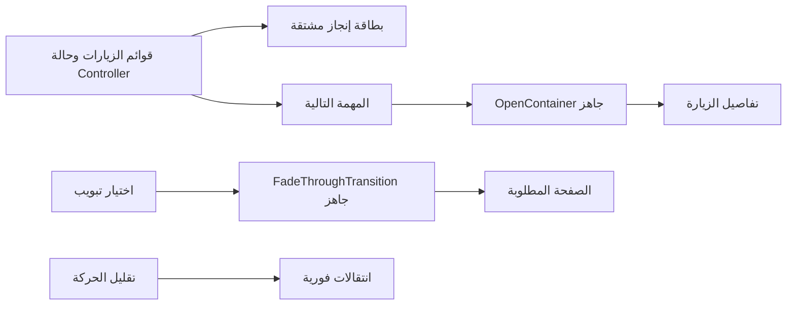

# 008 — مكونات جاهزة وتجربة ميدانية أوضح

## خطة التصميم والمراجعة

نحافظ على تفتيش وCairo والصور الأصلية، ونحسن العمل اليومي بدل إضافة زخارف متكررة.
المهارات: flutter-design، flutter-animation وfrontend-design.

- الألوان: deep teal `#006B65`، teal `#00867E`، ink `#102F3B`،
  mint `#E7F5F0`، background `#F5F9F8`، white `#FFFFFF`.
- Cairo: headlineLarge للتحية، headlineMedium للتقدم، titleLarge للمهمة التالية،
  bodyMedium للوقت والمنطقة. محاذاة البداية وفق RTL/LTR.
- الرئيسية: بطاقة إنجاز بلون عميق، مهمة تالية واضحة، اختصارات فعلية، ثم الجدول.
- شريط تنقل بسطح مستدير وحالة اختيار واضحة؛ الحركات تربط الفعل بوجهته فقط.
- النافذة الضيقة أو النص الكبير يحولان المكونات إلى ترتيب رأسي قابل للتمرير.

```text
  [صورة المفتش]                  [اللغة] [إشعارات]
  صباح الخير، أحمد
  [ إنجاز اليوم     25%   مكتملة 1 / متبقية 3 ]
  الزيارة القادمة
  [ أولوية / النشاط / الوقت والمنطقة / عرض الزيارة ]
  [زياراتي] [محاضري] [المساعدة] [المسار]
  جدول اليوم                           عرض الكل
  [زيارة] [زيارة]
  [الرئيسية]     [زياراتي]     [محاضري]
```

مراجعة الاتجاه: أرقام الإنجاز مشتقة من الزيارات الحالية؛ لا إحصاءات مخترعة.
الاختصارات تفتح صفحات أو مسارًا موجودًا، وليست أزرارًا شكلية. الإنشاء البصري
الأبرز هو بطاقة الإنجاز، وتبقى الحقول والمحتويات الأخرى هادئة.



## المصادر

راجعت Flutter Component Library في Chrome: Notification Custom Snackbar
ومعرض المكونات وتصنيفات التنقل. عارض المصدر للمكون الذي راجعته كان فارغًا
(`main.dart`, `1 lines`)؛ استُخدمت المعاينة كمرجع بصري، دون ادعاء نسخ كود غير متاح.
الكود الجاهز المستخدم فعليًا من مستودع Flutter الرسمي على GitHub، حزمة
animations 2.1.1 والأمثلة المرخصة BSD-3-Clause. انظر
[سجل المصادر والتراخيص](../COMPONENT_SOURCES.md).

## إتاحة المستودع

طلب المالك صراحة تحويل المستودع إلى Public في 13 نوفمبر 2026؛ تم التحقق من
GitHub API أن visibility=PUBLIC وisPrivate=false. فحص محلي منقح شمل 314 Git
blob منها 260 نصيًا عبر المراجع المحلية، ولم يجد أنماط المفاتيح أو أسماء ملفات
الأسرار التي يفحصها. هذا فحص أنماط شائعة وليس ضمانًا شاملًا لغياب كل سر.
تُحدث قواعد المشروع والوثائق لتوافق قرار المالك؛ لم يُنشأ إصدار متجر أو tag.

## المراجعة البصرية وحدود القياس

- Flutter Web profile في Chrome headless: عربية 430×932، إنجليزية 1100×850،
  وعربية 240×800 بخيار النص الكبير 1.3. روجعت الصور محليًا.
- [الرئيسية العربية](../screenshots/26-component-home-ar.png)،
  [الإنجليزية الواسعة](../screenshots/27-component-home-en-wide.png)،
  [وجهة انتقال الزيارة](../screenshots/29-component-visit-open.png).
- فتح الزيارة والرجوع، تبديل اللغة وحجم النص والتنقل تمت مراجعتها في المتصفح.
  لم تسجل أخطاء JavaScript؛ ظهرت 4 تحذيرات GPU readback في بيئة الرسم البرمجي.
- عينة requestAnimationFrame مدتها 1.2 ثانية أثناء فتح الزيارة: 63 فترة،
  الوسيط 16.7ms وp95=33.4ms والحد الأقصى 50ms. هذا قياس لتواتر المتصفح،
  وليس زمن Flutter UI/raster ولا إثبات 60fps مستمر أو أداء هاتف حقيقي.
- نجحت سياسة المشروع، 3 فحوص سياسة SDK، تنسيق 116 ملفًا، والتحليل بلا ملاحظات.
- نجحت 105 اختبارات، منها 12 جديدة للاختصارات والحركة المخفضة والتقدم الصفري
  ورسائل الخطأ وتخطيطات العربية والإنجليزية بعرض 240/360/1100 ونص يصل 2.08.
- نجح بناء Flutter Web release محليًا. بناء Android وفحوص النشر يتابعها PR.
- لا اختبار جهاز فعلي أو TalkBack/VoiceOver.

## إصلاحات مراجعة Qodo

- أضيفت هوية ValueKey بمعرّف الزيارة للمهمة التالية؛ عند إكمالها تزول بطاقة
  المصدر بدل إعادة استخدام حالتها لزيارة أخرى أثناء الرجوع.
- اختبار الحالة الجديدة فشل قبل الإصلاح ثم نجح: إكمال زيارة مفتوحة، التأكد من
  خروج مصدرها، الرجوع لتقدم 50% ثم فتح الزيارة التالية الصحيحة دون استثناءات.
- حُدثت عبارة التسليم الحالية في VERIFICATION.md إلى public demo prerelease؛
  لا يوجد tag أو نشر متجر، وملاحظات الإصدار التاريخية تبقى بتاريخها.
