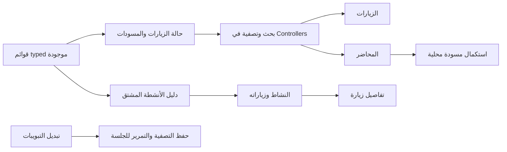

# 009 — زيارات ومحاضر أسهل في الاستخدام

## خطة التصميم قبل التنفيذ

الجمهور هو المفتش الذي يتنقل بين الزيارات والمسودات. نحافظ على Cairo والهوية
الحالية؛ الوضوح واستكمال العمل أهم من إضافة زينة أو بيانات جديدة.

- الألوان: ink `#102F3B`، deep teal `#006B65`، mint `#E7F5F0`،
  background `#F5F9F8`، white `#FFFFFF`، amber `#946000` للأولوية.
- Cairo: عنوان واضح، وقت بارز، اسم النشاط متوسط، بيانات مساعدة أقل وزنًا.
- الزيارات: خيارات ملتفة، بحث قابل للمسح، تاريخ، ونتائج قابلة للفتح.
- التصفية والترتيب في نافذة مستقلة بتطبيق وإلغاء حتى لا تزاحم الزيارات.
- المحاضر: أعداد مشتقة من السجلات، تصفية وبحث، واستكمال واضح للمسودة.
- دليل الأنشطة: صفحة من الزيارات الموجودة، ثم تفاصيل النشاط وزياراته ومحاضره.
- تبقى الاختيارات والتمرير عند تبديل التبويب داخل الجلسة؛ لا خادم جديد.

```text
 [صورة المفتش]                   [اللغة] [إشعارات]
 زياراتك                           [دليل الأنشطة]
 [اليوم] [القادمة] [المكتملة]
 [بحث بالاسم أو الرقم                   مسح]
 [الأسبوع السابق]     التاريخ      [الأسبوع التالي]
 [المنطقة] [الأولوية]      [ترتيب]
 نتائج التصفية                       إعادة الضبط
 [10:30     حالة / أولوية]
 [اسم النشاط / منطقة / فتح التفاصيل]
 [تنقل رئيسي ثابت مع حفظ الاختيارات]
```

مراجعة الاتجاه: لا نضيف إحصاءات مصطنعة أو صفحة تحميل وهمية؛ كل عدد وقائمة
من حالة الزيارات والمسودات. التصفية والبحث قابلان للإلغاء، والحالات الفارغة
تعطي طريقًا واضحًا لبدء زيارة. البطاقات اليومية تبرز الوقت بدل تكرار زخارف
الرئيسية؛ الدليل يخدم نشاطًا موجودًا فقط ولا ينشئ نشاطًا أو حسابًا حقيقيًا.

## الإرشادات المطبقة

- flutter-design وui-visual-design-system: هوية مشتركة ومكونات متجاوبة.
- frontend-design وmodern-web-design: تخطيط مقصود وحركة مرتبطة بفعل المستخدم.
- flutter-animation: الانتقال المحلي وتقليل الحركة.
- mobile-ux-design: حفظ سياق التبويبات وأهداف لمس 48px.
- accessibility-wcag: تسميات الحقول، لوحة المفاتيح ومعنى لا يعتمد على اللون.
- flutter-apply-architecture-best-practices: فصل الحالة والتصفية عن العرض.
- flutter-add-widget-test: اختبارات تفاعل وتنقل وفشل وحالات فارغة.
- playwright: تشغيل ملفات Flutter المبنية ومراجعة المتصفح واللقطات.



## نتيجة مراجعة الاستخدام

- نافذة التصفية تحتوي خياراتها حتى حد 85% من الشاشة وتتمدد للتمرير عند الحاجة.
  اختبار الحالة الضيقة فشل قبل الإصلاح (792px) ونجح بعد احتواء المحتوى.
- العد يدعم المفرد والمثنى والجمع بالعربية والمفرد والجمع بالإنجليزية؛ لا
  تظهر صياغات مثل «1 زيارات». تسمية البحث تبقى عائمة عند ضيق المساحة.
- التقويم يمنع اختيار أيام خارج نطاق نافذة التاريخ؛ اختبارا بداية ونهاية
  النطاق أثبتا اختيار 2025-12-28 و2028-01-01 قبل الإصلاح، ثم منعا الاختيار.
- راجعت Chrome Web profile من ملفات البناء عبر اعتراض طلبات محلي داخل المتصفح،
  دون تشغيل خدمة HTTP أو backend. العربية 430×932، الإنجليزية 1100×850،
  وعربية 240×800 مع نص 1.3 وتقليل الحركة. لا ادعاء بقياس أداء هاتف حقيقي.
- فُتح الدليل، وبُحث بالرقم الضريبي، وبدأت زيارة فعلية من القوائم، وحُفظت مسودة
  بملاحظة عربية وعلامة تحقق، ثم أعيد فتحها من المحاضر بنفس المحتوى.
- أغلقت نافذة التصفية بلوحة المفاتيح عبر Escape. المتصفح سجّل 0 أخطاء JavaScript
  و4 تحذيرات GPU readback في بيئة الرسم البرمجي.
- تسجل الفحوص النهائية وCI وcommit المعاينة في الإصدار وPR قبل اكتمال العمل.

## اللقطات

- [زيارات عربية](../screenshots/30-browse-visits-ar.png)
- [تصفية محتواة](../screenshots/31-browse-filters-ar.png)
- [محضر محفوظ من التفاعل](../screenshots/34-reports-draft-ar.png)
- [زيارات إنجليزية واسعة](../screenshots/35-browse-visits-en-wide.png)

لا backend أو مصادقة أو قياس GPS أو إرسال رسمي؛ التخزين التجريبي الحالي محفوظ
كما هو. اختبار الجهاز الحقيقي وقارئ الشاشة وiOS لم يُنفّذ في هذه الدورة.


## التحقق المحلي النهائي

127 اختبارًا نجحت، منها 22 جديدة تشمل التصفية المشتركة والترتيب، حالات البحث
الفارغة، حفظ سياق التبويبات والتمرير، الإلغاء والتطبيق، استكمال المسودات،
تقليل الحركة، حدود التقويم، و6 حالات تخطيط للعربية والإنجليزية بعرض
240/360/1100 مع نص يصل 2.08. فحص تسميات وأهداف اللمس Android اجتاز مكونات
المحاضر الجديدة؛ لا يُدّعى تدقيق WCAG شامل أو اختبار TalkBack/VoiceOver.
اجتازت القواعد و3 فحوص SDK والتنسيق والتحليل وبناء Web release.
