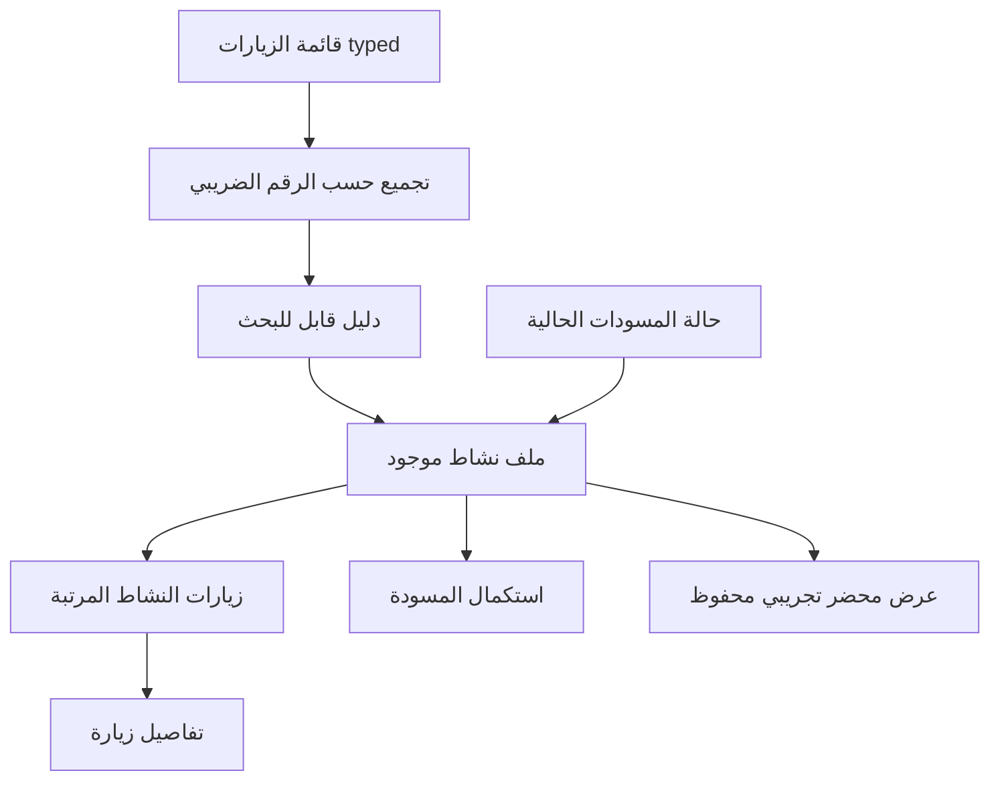

# 010 — دليل الأنشطة وملف النشاط

صفحتان محليتان: دليل قابل للبحث وملف نشاط يجمع الزيارات والمحاضر المحفوظة.
الدخول من زر دليل الأنشطة في تبويب زياراتي؛ الرجوع يحافظ على سياق التصفية.

## مصدر البيانات والتفاعل

- `Business.fromVisits` يجمع قوائم الزيارات حسب الرقم الضريبي دون تعديلها.
- بيانات الاسم والمنطقة والنوع تؤخذ من زيارة موجودة؛ لا أسماء أو أرقام جديدة.
- البحث يطابق الاسم العربي والإنجليزي والمنطقة والرقم الضريبي.
- كل زيارة تفتح تفاصيلها الحقيقية في النموذج، وكل مسودة تفتح قائمة التحقق.
- المحاضر تظهر من حالة الجهاز الفعلية، ولا يُخترع محضر للزيارة المكتملة في العينة.
- عدم وجود نتائج يعطي زرًا لمسح البحث؛ لا توجد إضافة نشاط أو حذف سجل أو API.

## التصميم

تستخدم الصفحات Cairo وألوان تفتيش وSlivers والرأس المثبت المتجاوب.
بيانات النشاط في سطح mint واضح؛ الزيارات ببطاقات وقت وحالة، والمحاضر بمؤشر
بنود التحقق ووصلة الاستكمال. الأرقام الغربية تبقى قابلة للقراءة والنسخ.
الحركة تتبع AppPageRoute وتفضيلات تقليل الحركة، مع تسميات فعلية وأهداف لمس 48px.

الحدود: بيانات تجريبية ثابتة، دون backend أو سجل أعمال رسمي أو مصادقة.
التخزين الحالي غير مشفر، ولا يلائم بيانات ضريبية حقيقية. تُسجل أدلة التحقق
والمراجعة البصرية مع الإصدار وPR؛ لا اختبار جهاز فعلي أو قارئ شاشة هنا.

## أدلة المراجعة

- [الدليل العربي](../screenshots/32-business-directory-ar.png) و[ملف النشاط](../screenshots/33-business-profile-ar.png).
- تجميع 5 زيارات في 4 أنشطة؛ نشاط المخبز له زيارتان من نفس القائمة.
- اختبارات تمنع تعديل القوائم وتثبت التنقل من النشاط إلى الزيارة ثم المسودة.
- الرقم الضريبي له عقدة Semantics مستقلة، قابلة للقراءة مع بقاء تحديد النص
  ونسخه. اختبار التسمية فشل قبل الإصلاح ثم نجح؛ هذا لا يعوّض قارئ شاشة فعليًا.
