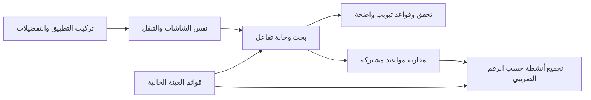

# 011 — تبسيط الكود مع الحفاظ على الواجهات

صيانة داخلية للنسخة 0.6.0: خطوات أوضح وأسماء تعبّر عن معناها، دون تغيير
التصميم أو النصوص أو قواعد التفاعل أو إصدار التطبيق الظاهر في الملف الشخصي.

## التغييرات

- تقسيم تركيب InspectorApp إلى إعداد التطبيق، اختيار الصفحة، وتطبيق التفضيلات؛
  نفس شجرة Widgets وترتيب Scopes وملكية Controllers والتنقل.
- شروط مبكرة واضحة لتصفية الزيارات، مع فصل قواعد تبويباتها عن البحث.
- Visit.compareSchedule يرتب حسب التاريخ ثم الوقت بدل تكرار المقارنة ثلاث مرات.
- تجميع الأنشطة وخيارات البحث في المحاضر بخطوات متتابعة بدل سلاسل متداخلة.
- AccessValidation يتحقق من طلب النموذج، ويترك حالة الإرسال لـAccessController.

## الحفاظ على السلوك

البحث يحتفظ بترتيب الحقول والمسافات ودعم استعلام يعبر حدود حقلين. تبويبا
القادمة والمكتملة يحتفظان بقواعد التاريخ والحالة الحالية. مجموعات الأنشطة
تحتفظ بترتيب أول ظهور وبقوائم غير قابلة للتعديل؛ نتائج المحاضر تحتفظ بترتيب
الإضافة العكسي والطول الثابت. لا تغيير لبيانات العينة أو التخزين أو الحفظ
واستعادة المسودات أو الإرسال التجريبي أو إعدادات المستخدم أو تقليل الحركة.

## التحقق

- أضيفت 7 اختبارات في test/readability_regression_test.dart ونجحت على الكود
  السابق أولًا: تبويبات وحالات زيارة، بحث مركب، تجميع وترتيب وعدم تعديل المدخلات،
  بحث وحالات المحاضر، ومتطلبات نماذج الدخول والتسجيل والاستعادة.
- نجحت الاختبارات المستهدفة بعد التبسيط (17 اختبار منطق).
- نجح فحص السياسة و3 اختبارات سياسة SDK والتنسيق والتحليل دون ملاحظات؛
  نجحت مجموعة Flutter الكاملة: 135 اختبارًا مع التغطية.
- نجح بناء Web release بالموارد المحلية وبدون تخزين Service Worker للمعاينة.
- 7 مقارنات صور قبل/بعد متطابقة بكسلًا على نفس الجهاز وSDK: الرئيسية بالعربية،
  الرئيسية بالإنجليزية على عرض 1100، الزيارات، نافذة التصفية، المحاضر، الملف
  بخط كبير، والترحيب. حُمّلت خطوط Cairo وMaterialIcons قبل التقاط الصور.
- ملف المقارنة ولقطات الأساس محليًا في output/refactor_visual_test.dart
  وoutput/refactor-baselines/؛ مخرجات تجاهلها Git لتجنب اختلاف الرسم بين الأنظمة.
  هذه مقارنة محلية محددة، وليست اختبارات صور متطابقة عبر جميع الأجهزة.

لا اعتماد جديد أو Backend أو تغيير منصة. كل ملف مكتوب يدويًا يبقى ضمن 300 سطر.
نتائج الفحص الكامل والبناء وCI ومعاينة commit النهائي تُسجّل في PR.
