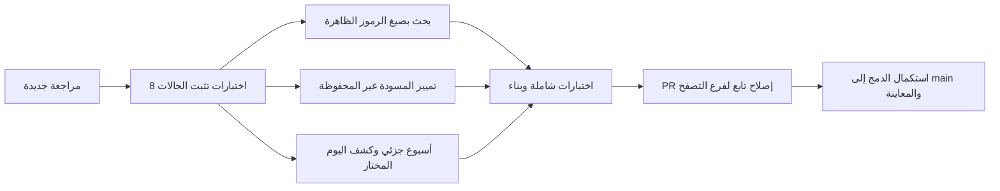

# 012 — إصلاح حالات البحث والتقويم والمسودات

صيانة للنسخة 0.6.0 بعد مراجعة CodeRabbit عند اعتماد سلسلة الدمج. تأكدت الملاحظات
باختبارات فاشلة قبل الإصلاح؛ بقيت الألوان والتخطيط وبيانات العينة والتخزين كما هي.

## السلوك

- البحث في المحاضر يقبل الرقم المجرد، الرمز الظاهر على البطاقة مثل #0241،
  والرمز المعروض في التفاصيل مثل DEMO-V-0241، مع بقاء بحث الاسم والرقم الضريبي.
- عنوان ملف النشاط أصبح «محاضر النشاط». تظهر المسودة التي لم تُحفظ بنجاح بعد
  باسم «مسودة غير محفوظة»، وتبقى متاحة للمتابعة. نجاح الحفظ يعيد حالة «مسودة».
  لا تُحذف سجلات الذاكرة لإخفاء الفرق، ولا يتغير مخطط التخزين.
- أزرار الأسبوع تسمح بالأسبوع الجزئي عند طرفي نطاق التاريخ. يقتصر التاريخ
  المختار على أول/آخر يوم مسموح، وتبقى الخلايا خارج النطاق غير قابلة للاختيار.
- تغيير التاريخ يكشف خليته في الشريط الأفقي، دون تحريك صفحة الزيارات رأسيًا.
  يحتفظ تبديل التبويبات بموضع الشريط الحالي؛ لا نفرض إعادة تمركز عند استعادته.
  حركة الكشف تحترم إعداد تقليل الحركة.

## التنفيذ والفحص

DateStrip في ملف مستقل visit_date_strip.dart، مع إعادة تصديره من visit_filters.dart
لإبقاء استخدامه واضحًا ومتوافقًا. سبع خلايا ثابتة داخل تمرير أفقي أصلي؛ لكل خلية
مفتاح، وللشريط ScrollController وPageStorageKey مستقلان. الكشف يستهدف موضع
الشريط فقط، ويعمل بالعربية والإنجليزية ومع/دون حركة.

ثمانية اختبارات جديدة تشمل صيغ الرموز، انتقال حالة المسودة بعد الحفظ، الأسبوعين
الجزئيين، وأربع حالات كشف لليوم المختار حسب اللغة وإعداد الحركة. نجحت أولًا
18 حالة مستهدفة مع اختبارات الحدود والتنقل السابقة. نجحت المجموعة الكاملة:
136 اختبارًا مع التغطية، والسياسة و3 فحوص SDK والتنسيق والتحليل دون ملاحظات.
نجح بناء Web release، وبقيت مقارنات اللقطات السبع مطابقة بكسلًا لنفس حالات
الرئيسية والزيارات والتصفية والمحاضر المحفوظة والملف والترحيب. تسميات المسودة
غير المحفوظة وعنوان ملف النشاط تغيرت عمدًا لتصحيح الوصف. أدلة CI ومعاينة commit
تُسجل في PR قبل اعتماد الإصلاح.

لا Backend أو حزم جديدة أو تغيير لبيانات المستخدم. savedAt يدل على آخر حفظ ناجح؛
هذا الإصلاح لا يضيف نظام تتبع تفصيلي للتعديلات غير المحفوظة بعد ذلك الحفظ.
