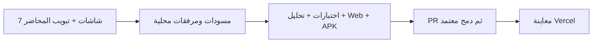

# 0.1.0 — الشاشات الأساسية والمعاينة

- [001: تدفق التفتيش](../features/001-inspection-flow.md).
- [002: معاينة Vercel](../features/002-vercel-preview.md).
- 24 اختبار regression في النسخة الأساسية، تحليل وبناء Web وAPK عبر CI.
- [أدلة النسخة](../VERIFICATION.md) و[قواعد التطوير](../../AGENTS.md).

هذا عرض تجريبي ببيانات نموذجية؛ لا إرسال ضريبي رسمي أو GPS أو مصادقة.
