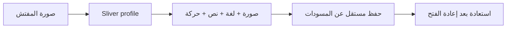

# 0.2.0 — ملف المفتش وتجربة شخصية

- [003: صورة المفتش والإعدادات](../features/003-inspector-profile.md).
- الصورة في الشريط تفتح صفحة Sliver متجاوبة مع بطاقات لغة وحجم نص وتقليل حركة.
- اختيار وإزالة الصورة مع حفظ التفضيلات محليًا؛ لا توجد حزم إضافية.
- توثيق الميزات والإصدارات ومخططاتها أصبح قاعدة مساهمة دائمة.

التحقق المحلي: فحص السياسة والتنسيق، تحليل دون ملاحظات، **35 اختبارًا ناجحًا**
(24 سابقًا + 11 للملف الشخصي)، وبناء Flutter Web release ناجح.
فحص Chrome عند 430×932 شمل فتح الملف، اختيار صورة اختبار، تغيير اللغة وحجم النص
وتقليل الحركة، ثم إعادة التحميل والتحقق من الاستعادة. اختبارات layout شملت
360×800 و900×850 باللغتين وتكبير 1.3. صور الأدلة أدناه؛ الصورة الملونة المستخدمة
في اختبار المنتقي ليست صورة مفتش ولا تُشحن كصورة افتراضية.

- [الرئيسية والصورة الدائرية](../screenshots/09-avatar-home.png).
- [الملف بالعربية](../screenshots/10-profile-ar.png).
- [الإعدادات بالإنجليزية والخط الكبير والرأس المنطوي](../screenshots/11-profile-en-large-collapsed.png).

نتائج CI وAPK ومعاينة فرع الميزة تُسجل في PR. الدمج يحتاج اعتمادًا مستقلًا عن PR #1 وPR #2.
الصورة الافتراضية رمز شخص؛ الاسم نموذج موجود، والتخزين غير مشفر.
