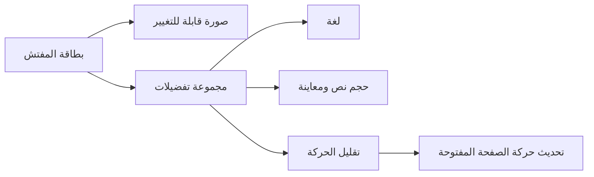

# 0.3.0 — بطاقة المفتش وتجربة إعدادات محسّنة

- [005: التصميم والحركة](../features/005-profile-design-polish.md).
- بطاقة هوية بمحاذاة RTL/LTR، صورة أكبر مع إجراء كاميرا واستجابة ضغط، وتجميع
  التفضيلات داخل سطح واحد. تتحول اللغة وحجم النص إلى اختيارات بمؤشر منزلق.
- معاينة لحجم النص باسم المفتش من قائمة العينة، مع تخطيط بعمودين عند اتساع النافذة.
- بطاقة بمقاس محتواها وترتيب رأسي عند ضيق النافذة؛ عنوان مثبت يتكيف مع تكبير
  النظام. اختبارات انحدار لحالة Qodo عند 240px ولغتي العرض عند تكبير 2.08×.
- Hero للصورة وانتقال دخول 320ms وخروج 220ms؛ تقليل الحركة يحدّث انتقال الصفحة
  المفتوحة أيضًا، ويوقف المؤشر المتحرك واستجابة الضغط الزخرفية.
- نفس Cairo والألوان والخدمات، ودون حزم جديدة أو تغيير المسودات والبيانات المحفوظة.

هذا الإصدار مبني على فرع PR #3 المفتوح، ويُراجع في PR مستقل. نجحت 61 من اختبارات
Flutter و3 حالات للسياسة، والتحليل وبناء Web في profile وrelease. الصور وحدود
فحص الأداء موجودة في [ملف الميزة](../features/005-profile-design-polish.md)، ونتيجة
CI ومعاينة الفرع تسجل في PR. اختبار TalkBack/VoiceOver على أجهزة
فعلية وأداء Android/iOS على الأجهزة لم يُنفّذ ضمن مراجعة الويب هذه.
