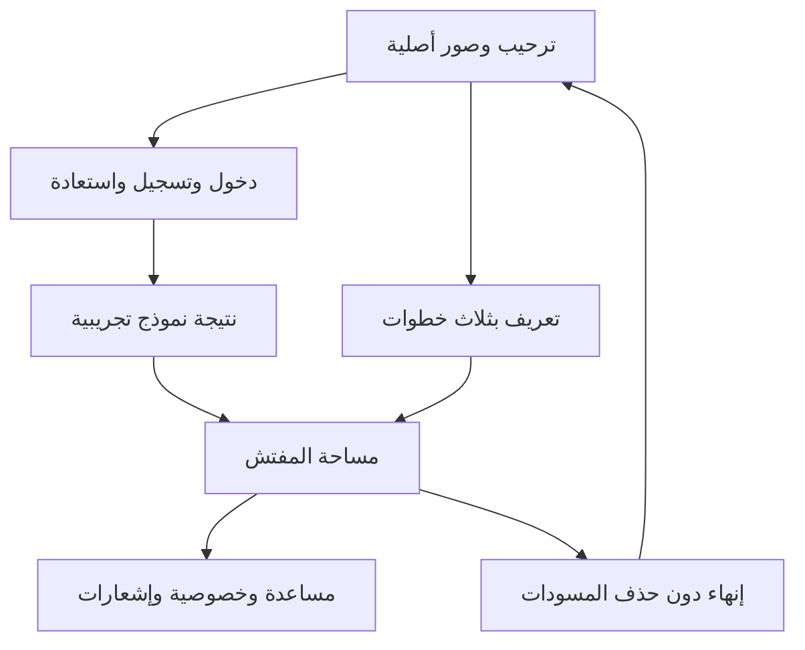

# 0.4.0 — الوصول والأساسيات

- [006: الترحيب والدخول وإنشاء الحساب](../features/006-access-experience.md).
- [007: المساعدة والإشعارات والخصوصية](../features/007-app-essentials.md).
- صورتان أصليتان مولدتان خصيصًا لتفتيش؛ [الأصول والنصوص المستخدمة](../GENERATED_ASSETS.md).
- تعريف بثلاث خطوات، تحقق الحقول وإظهار كلمة المرور، استعادة تجريبية،
  ومغادرة مؤكدة تحافظ على المسودات والتفضيلات.
- قوائم نموذجية typed للمحتوى والأسئلة والإشعارات. لا حزم جديدة.
- هذه واجهات تجريبية دون خادم حسابات: لا مصادقة حقيقية، إنشاء حساب، إرسال بريد،
  حفظ كلمات مرور، إشعارات دفع أو تغيير لصلاحيات الوصول إلى بيانات حقيقية.

نجحت **89 من اختبارات Flutter** و3 حالات SDK-only لبوابة السياسة. نجح التنسيق
والتحليل دون ملاحظات، وبناء Web بوضع profile وبناء release النهائي. راجعت Chrome
باللغتين، بما فيه 240px وتكبير النص، والتدفقات المذكورة في ملفات الميزات.
لقطات الواجهات وقياس وتيرة المتصفح وحدوده في تلك الملفات. CI وAPK ومعاينة
الفرع ذات commit المطابق تسجل في PR. لا يشمل ذلك اختبار الأجهزة الفعلية أو iOS.
