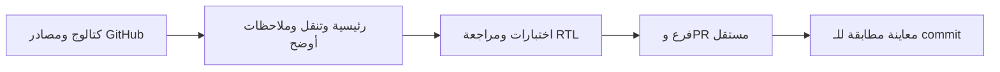

# 0.5.0 — المكونات الجاهزة وتحسين العمل الميداني

- [008: التصميم والمصادر وإتاحة المستودع](../features/008-component-library-ui.md).
- بطاقة إنجاز مشتقة من القوائم، مهمة تالية أوضح، اختصارات فعلية وتنقل محسّن.
- OpenContainer وFadeThroughTransition من animations 2.1.1، مع تقليل الحركة.
- [المصادر والتراخيص](../COMPONENT_SOURCES.md) و[الحزم](../PACKAGES.md).
- أصبح المستودع Public بطلب صريح من المالك؛ لا نشر متجر أو حسابات حقيقية.

نجحت 105 اختبارات، 3 فحوص سياسة SDK، فحص الملفات والتوثيق، التنسيق والتحليل،
وبناء Web release. روجعت العربية والإنجليزية والنص الكبير في Chrome profile؛
الأدلة والقيود في ملف الميزة. تظل الحسابات والإرسال محلية تجريبية؛ CI ومعاينة
الفرع موثقان في PR، ولا دمج تلقائي أو إصدار متجر.

- إصلاح مراجعة Qodo: هوية مستقلة لبطاقة كل زيارة وتوضيح إتاحة تسليم النسخ.
